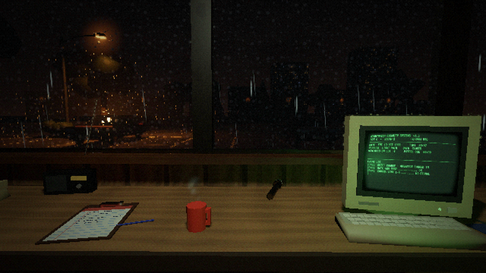
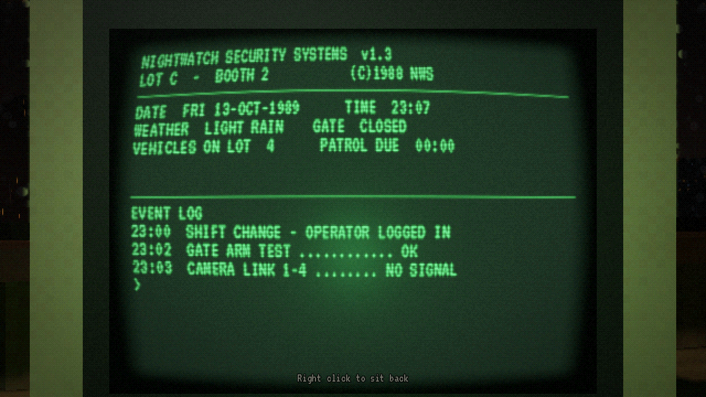
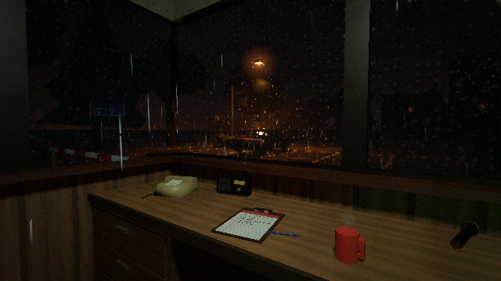
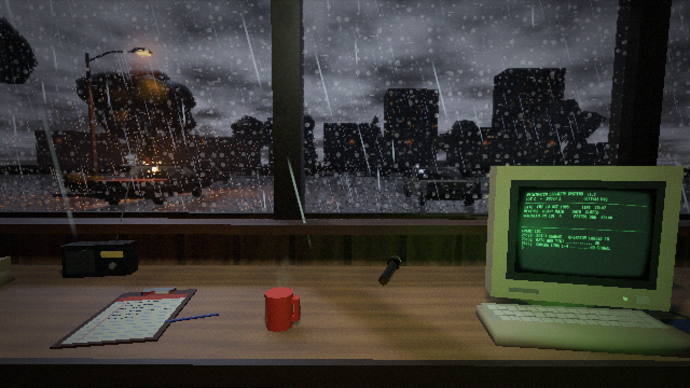
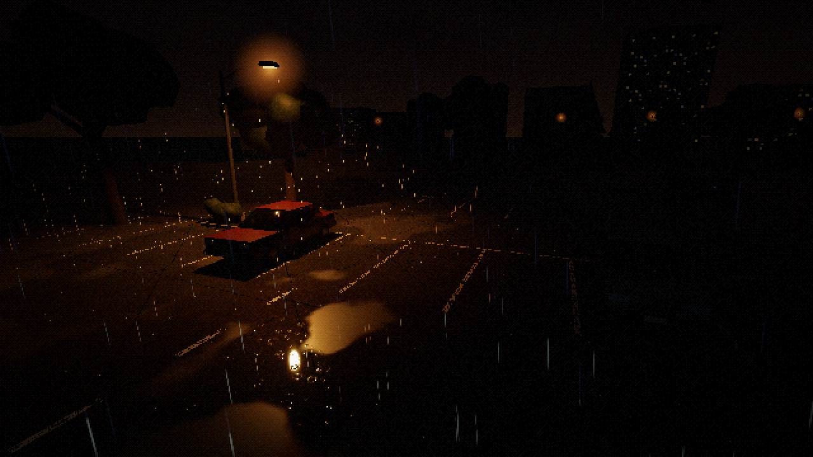
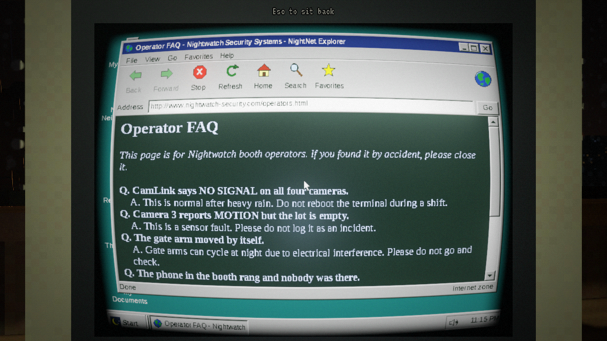
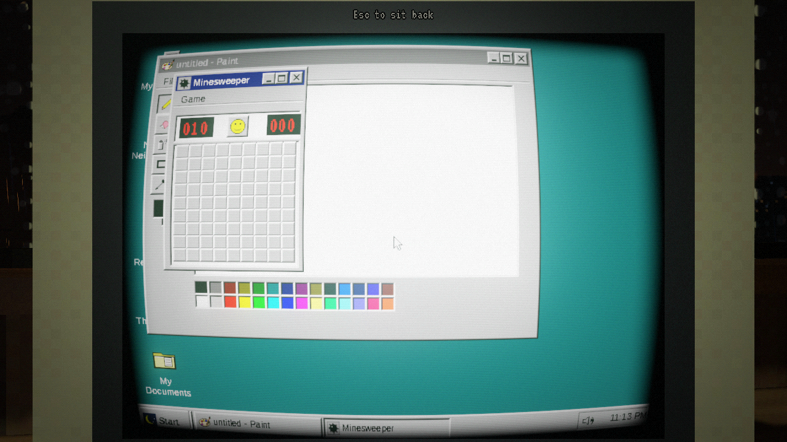

# Dark Park

A spooky ambience game. It is October 1989 and you work the night shift in a
car park security booth. You sit at your desk with a beige CRT terminal in front
of you. Through the big rain-streaked window there is a dark car park, lit only
by one sodium street lamp and the light spilling from your booth.

Built with **Godot 4.4** (free, open source) and exports to a standalone Windows `.exe`.



| | |
|---|---|
|  |  |
|  |  |

## Status: location build (v0.1)

The location and its ambience are done; missions and story come next.

* **Booth:** wood-panelled walls, desk with drawers, sill, flickering fluorescent
  tube, wall clock that follows the in-game time, calendar (Friday 13th circled),
  cork board, filing cabinet, a door.
* **Desk:** green-phosphor CRT terminal (live time, weather, event log), keyboard,
  mouse, push-button phone, logbook, coffee with steam, flashlight.
* **Radio:** a transistor radio playing a late-night station (seven CC0 tracks through a
  small-speaker filter with FM hiss). The sound comes from the radio itself, so it pans
  as you look around. Click it to switch it off and on. The dial glows when it is on.
* **Car park:** wet asphalt with puddles that reflect the lamp and ripple in the rain,
  worn bay lines, three parked cars and a van, a barrier gate, the "LOT C" sign,
  a payphone, a chain-link fence, the tree line, and a distant town with a few lit windows.
* **Lighting:** an orange sodium lamp with a volumetric cone through the mist, a halo,
  shadows and the occasional sputter. Light from the booth spills out onto the lot.
  The CRT throws a green glow, and the glass reflects the interior.
* **Weather:** rain with mist that drifts between light drizzle and heavy downpours,
  wind gusts, and lightning during heavy spells (sky flash plus delayed thunder).
  Raindrops bead and run down the windows, water drips off the roof edge, and rain
  is only visible where light catches it.
* **Trees:** every tree and bush sways in the wind. The bend increases with height,
  leaves flutter, and the shadows under the lamp move too.
* **Sound:** layered rain (light, heavy, roof, window, gutter), wind, distant traffic,
  thunder, fluorescent hum, CRT whine, lamp buzz, ticking clock and creaking trees.
  Outdoor sounds are muffled through the glass and indoor sounds are positional.
* **PS1-era look:** 640×360 internal resolution, nearest-neighbour textures,
  15-bit colour with ordered dithering, film grain and a vignette.

## The computer (NightWin 95)

Click the CRT to lean in. You get the green Nightwatch terminal first; **click the glass** (there is
a prompt at the bottom) to start the workstation: BIOS text, a splash screen, then a
Windows-95-style desktop with a Start menu, taskbar, draggable/resizable windows and a mouse
cursor. The PC is fully usable with the mouse and keyboard.

| Program | What it does |
|---|---|
| **NightNet Explorer** | Web browser. Shows a fictional 1990s web (a local paper, a national news wire built from real 1995 headlines, a parking authority, a security-company site, a personal homepage, a night-shift message board, a weather page, a search engine...). Type words in the address bar to search it. It can also open **real** pages (see below). |
| Mail | A small inbox of messages from the night team. Compose a message and you may get a reply. |
| Notepad | Edit and save text files on the fake disk. Opens the shift notes, patrol sheet, etc. |
| Paint | Pencil, brush, eraser, fill, spray, line, rectangle, ellipse, colour picker. |
| Calculator, Minesweeper | They work. |
| MS-DOS Prompt | `dir`, `cd`, `type`, `cls`, `ver`, `ping`, `who`, `edit`, `start`... |
| My Computer / Explorer | Browse drives A:, C:, D:, Control Panel, Network Neighborhood and the Recycle Bin. Double-click to open. |
| Gate Control | Opens and closes the **real** barrier gate in the car park. |
| CamLink | Camera viewer. Placeholder: every camera says NO SIGNAL until real 3D cameras exist. |
| Run..., Find, Help, Display and Date/Time properties | As you would expect. |

Start > Shut Down > *Restart in MS-DOS mode* takes you back to the green terminal. Look in the
folders on the C: drive, the floppy in A:, the Recycle Bin and the Inbox for the story.

| | |
|---|---|
|  |  |

### Real web pages

The browser first "dials" the modem (a dialog with modem sounds), then can open real `http://` and
`https://` pages: type an address, or follow the links on the NightNet Start Page (info.cern.ch,
example.com, FrogFind, NPR text-only news...). Pages are shown by a small built-in HTML renderer:
text, headings, links, lists, tables, `<pre>`, `<font>` colours and sizes. There is no JavaScript or
CSS, so modern sites look like old ones; text-heavy and "lite" sites work best. Images on real
pages show their alt text. A proxy in `HTTP_PROXY`/`HTTPS_PROXY` is honoured.
Real requests go out from the player's own machine, like any browser; nothing is sent until the
player chooses to connect. To turn it off, make `os.gd`'s `Dialogs.dialup` refuse (or remove the
`Pages.has_host` fallback in `apps/browser.gd`).

## Controls

The game is played entirely with the mouse.

| Input | Action |
|---|---|
| Move mouse | Look around (move toward a screen edge to turn your head) |
| Left click | Use what you are pointing at (its name appears at the bottom) |
| Click the CRT | Lean in to the terminal |
| Click the radio | Switch the music on/off |
| Right click | Sit back (at the desktop, right click is the PC's right button; right click the monitor frame to sit back) |
| Esc | Close a menu or dialog on the PC, else sit back, else pause (Q quits while paused) |
| Keyboard | Typing works while you are using the PC |
| F11 | Toggle fullscreen |

Developer keys (for testing the atmosphere):

| Key | Effect |
|---|---|
| F1 / F2 / F3 / F4 | Weather: clear / rain + mist / storm / fog |
| F5 | Lightning strike now |
| F6 | Toggle a heavy-rain spell |
| F7 | Make the booth light flicker |
| F8 | Open/close the barrier gate |
| F9 | Show the weather readout and FPS |

## Running it

1. Install [Godot 4.4](https://godotengine.org/download) (standard build, not .NET).
2. Open Godot, click **Import**, and pick this folder's `project.godot`.
3. Press **F5** (Run).

## Building the .exe

**In the editor:** Project → Export → *Windows Desktop* → Export Project.
The first time, Godot will offer to download the export templates.
The game is a single `DarkPark.exe` (about 100 MB) with everything embedded.

**From the command line:**

```bash
godot --headless --path . --export-release "Windows Desktop" build/windows/DarkPark.exe
```

**Automatically:** every push runs `.github/workflows/build.yml`, which exports the
`.exe` and attaches it to the run (GitHub → Actions → latest run → Artifacts → `DarkPark-windows`).

## Project layout

```
project.godot              Godot project (autoloads, global shader values)
scenes/main.tscn           Entry scene
scripts/
  main.gd                  Low-res render pipeline, input, dev keys, screenshot mode
  autoload/weather.gd      Weather state + profiles (the story controls weather here)
  autoload/night_clock.gd  In-game time (23:04 -> morning)
  world/world.gd           Environment, sky, fog, glow; assembles the location
  world/booth.gd           Booth architecture, ceiling light, clock, decor
  world/desk_props.gd      CRT, keyboard, phone, radio, logbook, mug...
  world/parking_lot.gd     Ground, lines, cars, gate, sign, fence, trees, town
  world/street_lamp.gd     Sodium lamp (light, halo, sputter)
  world/barrier_gate.gd    Barrier arm with open()/close()
  world/weather_fx.gd      Rain, splashes, roof drips, lightning, mist density
  world/ambience.gd        All ambient audio and mixing
  world/tree_builder.gd    Low-poly tree/bush generator
  world/car_builder.gd     Low-poly car/van generator
  player/desk_camera.gd    Seated mouse-look, hover, zoom to CRT
  player/interactable.gd   Clickable objects (phone, radio, logbook, CRT)
  ui/crt_terminal.gd       The terminal screen contents
  ui/hud.gd                Prompt text, pause screen, cursor
  desktop/os.gd            NightWin 95: boot, desktop, taskbar, Start menu, window manager
  desktop/w95.gd           Win95 look: bevels, Theme, fonts, cursors
  desktop/window.gd        Window frame (drag, resize, minimise/maximise/close)
  desktop/dialogs.gd       Message box, Run, Shut Down, dial-up, file dialog...
  desktop/html_view.gd     HTML -> RichTextLabel renderer (fake and real pages)
  desktop/web_pages.gd     The fictional 90s web
  desktop/vfs.gd           The fake disk and its files
  desktop/apps/            Browser, Mail, Notepad, Paint, DOS, Minesweeper, Calculator, ...
  util/mesh_kit.gd         Geometry + material helpers
shaders/                   Rain, window glass, wet ground, foliage, sky, CRT, post FX
assets/audio/              Sound effects (see assets/audio/CREDITS.md)
assets/textures/           Generated PS1-style textures (replace with hand-made art any time)
assets/fonts/              VT323 terminal font, Liberation fonts for the desktop (SIL Open Font License)
assets/desktop/            Generated icons and web graphics for the desktop
tools/                     Scripts that rebuild the textures, sounds and desktop art;
                           desktop_test.gd / desktop_interact_test.gd run the desktop on its own
```

The location is built in code, so tweaking a position or colour means changing one
number. Pieces can be moved into hand-made `.tscn` scenes whenever that is more convenient.

## Hooks ready for the story

```gdscript
Weather.set_profile("storm")          # clear, rain_mist, drizzle, storm, fog
Weather.force(0.0, 0.05, 1.0, 30.0)   # exact rain, wind, fog over 30 s
Weather.strike_lightning()
NightClock.set_time(2, 13)
world.booth.set_power(0.0)            # kill the booth light
world.booth.force_flicker()
world.lot.lamp.level = 0.0            # street lamp off
world.lot.gate.open()
world.props.terminal.add_log("MOTION DETECTED - ROW C")
world.props.radio_player.set_on(false)   # radio off (e.g. for a scare)
world.props.desktop.open_app("notepad", {"path": "C:\\MY DOCUMENTS\\SHIFT NOTES.TXT"})
world.props.desktop.vfs.write("C:\\MY DOCUMENTS\\NEW.TXT", "...")   # drop a file on the PC
world.props.desktop.mailbox.append({"from": "?", "subj": "...", "date": "Now", "unread": true, "body": "..."})
world.props.phone_interact.activated.connect(...)  # phone, radio, logbook, CRT
```

## Credits

* Sounds and radio music: CC0 recordings from OpenGameArt.org plus synthesised effects. See
  [assets/audio/CREDITS.md](assets/audio/CREDITS.md).
* Fonts: [VT323](https://fonts.google.com/specimen/VT323) by Peter Hull and the
  [Liberation fonts](https://github.com/liberationfonts), both SIL Open Font License.
* Everything else (textures, models, shaders) was made for this project.
